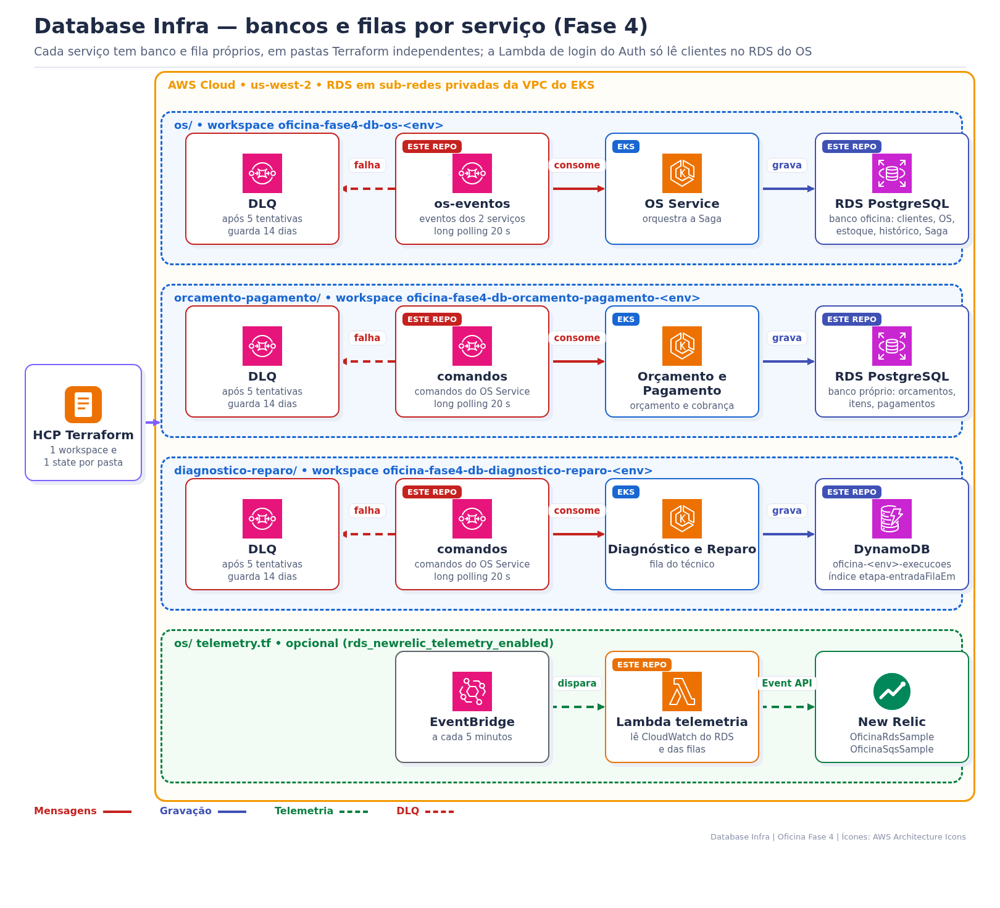

> **Tech Challenge Fase 4 — `oficina-database-infra`**
>
> Bancos de dados e filas da Saga, **um conjunto isolado por serviço**, em Terraform.

# Oficina Fase 4 — Database Infra

## 1. Objetivo de negócio

Na Fase 4 a oficina foi dividida em três serviços. Cada um é dono dos seus dados e só conversa com os outros por mensagens. Este repositório cria esses bancos e essas filas:

- o **OS Service** guarda clientes, veículos, catálogo, estoque, Ordens de Serviço e o histórico de status;
- o **Orçamento e Pagamento** guarda orçamentos, itens e pagamentos (fake ou Mercado Pago);
- o **Diagnóstico e Reparo** guarda a fila do técnico e o andamento de cada execução;
- as **filas SQS** levam os comandos e eventos da Saga, e as **DLQs** guardam o que falhou 5 vezes para análise.

Nenhum serviço lê o banco de outro. A Lambda de login do [Auth Serverless](https://github.com/tiagomiele/oficina-auth-serverless) também não acessa o RDS: ela consulta o cliente no OS Service por REST (`POST /interno/clientes/autenticacao`).

## 2. Arquitetura



Cada pasta tem **workspace HCP, state e workflow próprios**: aplicar um banco não altera os outros.

| Pasta | Banco | Fila principal → DLQ | Workspace HCP | Workflow |
|---|---|---|---|---|
| `os/` | RDS PostgreSQL 16 (`oficina`) | `oficina-<env>-os-eventos` → `…-dlq` | `oficina-fase4-db-os-<env>` | `os.yml` |
| `orcamento-pagamento/` | RDS PostgreSQL 16 próprio (`oficina`) | `oficina-<env>-orcamento-pagamento-comandos` → `…-dlq` | `oficina-fase4-db-orcamento-pagamento-<env>` | `orcamento-pagamento.yml` |
| `diagnostico-reparo/` | DynamoDB `oficina-<env>-execucoes` | `oficina-<env>-diagnostico-reparo-comandos` → `…-dlq` | `oficina-fase4-db-diagnostico-reparo-<env>` | `diagnostico-reparo.yml` |

`modules/sqs-com-dlq/` é o único código compartilhado. `<env>` é `homolog` ou `production`.

**Quem publica e quem consome:**

| Fila | Publica | Consome |
|---|---|---|
| `os-eventos` | Orçamento e Pagamento, Diagnóstico e Reparo | OS Service (orquestrador da Saga) |
| `orcamento-pagamento-comandos` | OS Service | Orçamento e Pagamento |
| `diagnostico-reparo-comandos` | OS Service | Diagnóstico e Reparo |

Cada mensagem traz `messageId` e `correlationId`; o destinatário grava o `messageId` em `mensagens_processadas` (ou equivalente) para não aplicar a mesma mensagem duas vezes. O detalhe de cada comando e evento está na documentação da Saga no [OS Service](https://github.com/tiagomiele/oficina-os-service).

## 3. Requisitos funcionais

| Requisito | Onde está |
|---|---|
| Banco relacional do OS (clientes, OS, estoque, histórico, controle da Saga) | `os/main.tf` |
| Banco relacional próprio do Orçamento e Pagamento | `orcamento-pagamento/main.tf` |
| Tabela NoSQL da fila do técnico, com consulta por etapa em ordem de chegada | `diagnostico-reparo/main.tf` (índice `etapa-entradaFilaEm-index`) |
| Fila de eventos e duas filas de comandos da Saga | `*/messaging.tf` |
| Mensagem que falha 5 vezes vai para a DLQ e fica 14 dias | `modules/sqs-com-dlq/main.tf` |
| Endereços do banco e das filas entregues aos serviços sem credenciais no Git | `outputs.tf` + `scripts/sync-database-outputs.py` |
| Métricas do RDS e das filas no New Relic (opcional) | `os/telemetry.tf` + `os/lambda/rds_newrelic_telemetry.py` |

## 4. Requisitos técnicos

| Item | RDS (`os/` e `orcamento-pagamento/`) | DynamoDB (`diagnostico-reparo/`) | SQS (módulo) |
|---|---|---|---|
| Rede | sub-redes privadas, `publicly_accessible = false`, porta 5432 liberada só para o Security Group do EKS | endpoint AWS, acesso pela LabRole | endpoint AWS, acesso pela LabRole |
| Criptografia | `storage_encrypted = true` e `rds.force_ssl = 1` | SSE ativado | `sqs_managed_sse_enabled` |
| Capacidade | `db.t3.micro`, 20 GB, crescendo até 40 GB | `PAY_PER_REQUEST` | — |
| Mensageria | — | — | visibilidade 60 s, retenção 4 dias, long polling 20 s, `maxReceiveCount = 5`, DLQ 14 dias |
| Logs | `postgresql` no CloudWatch (7 ou 14 dias), consultas acima de 1 s e DDL | — | — |

**Homologação × produção** (valores aplicados pelo `configure-environment.ps1`):

| Configuração | homolog | production (AWS Academy, descartável) | production endurecida |
|---|---|---|---|
| Backup | 7 dias | 14 dias | 14 dias |
| Multi-AZ | não | não | sim |
| Proteção contra exclusão | não | não | sim |
| Snapshot final no destroy | não | não | sim |

O perfil descartável (`-UseAwsAcademyDisposableProductionProfile`) é o usado no AWS Academy, para o destroy liberar os créditos sem bloqueio.

## 5. Stack técnica

| Área | Tecnologias |
|---|---|
| Bancos | Amazon RDS PostgreSQL 16 (2 instâncias) e Amazon DynamoDB |
| Mensageria | Amazon SQS com DLQ e redrive |
| Infraestrutura | Terraform ≥ 1.6, provider AWS, HCP Terraform (1 workspace por pasta e ambiente) |
| Credenciais AWS | `LabRole` do AWS Academy; o repositório não declara IAM |
| Telemetria | AWS Lambda Python, EventBridge (`rate(5 minutes)`), CloudWatch e New Relic Event API |
| Schema SQL | Flyway nos próprios serviços (OS V1–V5, Orçamento e Pagamento V1) |
| Qualidade | `terraform fmt/validate/test`, TFLint, testes Python (`unittest`) e `validate_docs.py` |
| Segurança | Checkov, Trivy, Gitleaks e actionlint |
| Automação | GitHub Actions, GitHub Environments e GitHub App para sincronizar outputs |

As tabelas SQL não são criadas aqui: cada serviço aplica as próprias migrations Flyway ao subir.

## 6. Bancos de dados e como ver os dados

### 6.1 RDS do OS Service

| Tabela | Conteúdo |
|---|---|
| `clientes`, `veiculos` | cadastro (CPF/CNPJ normalizado, `ativo`) |
| `users` | usuários administrativos |
| `servicos`, `pecas`, `estoque_pecas`, `movimentacao_estoque_pecas` | catálogo e estoque |
| `notas_fiscais_fornecedor`, `itens_nota_fiscal_fornecedor` | entrada de peças |
| `ordens_servico`, `numero_os_sequencia`, `historico_status_ordem_servico` | OS, numeração e histórico de status |
| `orcamentos`, `itens_orcamento`, `orcamentos_itens_ordem_servico`, `conta_corrente_oficina` | tabelas herdadas da Fase 3 |
| `mensagens_processadas` | IDs das mensagens da Saga já aplicadas (idempotência) |

O modelo completo está em [modelo relacional](docs/modelo-relacional.md), [diagrama](docs/assets/modelo-relacional-database.png), [índices](docs/indices-desempenho.md) e [ADR](docs/adr/0001-consistencia-modelo.md).

### 6.2 RDS do Orçamento e Pagamento

`orcamentos`, `itens_orcamento`, `pagamentos` e `mensagens_processadas`. O detalhe e as consultas prontas estão no [README do serviço](https://github.com/tiagomiele/oficina-orcamento-pagamento-service#readme).

### 6.3 Ver os dados do RDS (DBeaver ou `psql`)

O RDS é privado: não tem endereço público, e o *Query Editor* do console só funciona com Aurora. Por isso o acesso é por um **túnel temporário** dentro do cluster (pod `pg-tunnel`) e um cliente SQL no seu computador (DBeaver, pgAdmin ou `psql`).

Antes: Lab iniciado e o ambiente escolhido no ar, com nodes no cluster (`kubectl get nodes` mostra 2 `Ready`; sem nodes, o `pg-tunnel` fica `Pending`). Abra uma janela PowerShell **só para o túnel**, rode o bloco e deixe a janela aberta. Se ela fechar, o túnel cai.

```powershell
$amb   = 'homolog'                     # ou 'production'
$porta = if ($amb -eq 'production') { 25432 } else { 15432 }   # uma porta por ambiente
aws eks update-kubeconfig --region us-west-2 --name "oficina-$amb"   # aponta o kubectl para o cluster do ambiente
# OS Service. Para o Orçamento e Pagamento troque as 3 linhas abaixo por:
#   $ns="oficina-orcamento-pagamento-$amb"; $cm='orcamento-pagamento-config'; $sec='orcamento-pagamento-secrets'; $porta += 1
$ns  = "oficina-$amb"
$cm  = 'oficina-config'
$sec = 'oficina-secrets'
kubectl get ns $ns 2>$null | Out-Null
if ($LASTEXITCODE -ne 0) { throw "Namespace $ns não existe no cluster oficina-$amb. Confira se o ambiente está no ar (kubectl get ns)." }
$url = kubectl get configmap $cm -n $ns -o jsonpath='{.data.DB_URL}'
$dbHost = $url -replace '^jdbc:postgresql://([^:/]+).*$', '$1'
"Usuario: " + (kubectl get configmap $cm -n $ns -o jsonpath='{.data.DB_USER}')
"Database: " + ($url -replace '^.*/', '' -replace '\?.*$', '')
$b64 = kubectl get secret $sec -n $ns -o jsonpath='{.data.DB_PASSWORD}'
[Text.Encoding]::UTF8.GetString([Convert]::FromBase64String($b64)) | Set-Clipboard   # senha na área de transferência
kubectl delete pod pg-tunnel -n $ns --ignore-not-found               # sobra de uma sessão anterior
kubectl run pg-tunnel -n $ns --image=alpine/socat --restart=Never -- "tcp-listen:5432,fork,reuseaddr" "tcp-connect:${dbHost}:5432"
kubectl wait pod/pg-tunnel -n $ns --for=condition=Ready --timeout=180s
if ($LASTEXITCODE -ne 0) {
  kubectl describe pod pg-tunnel -n $ns | Select-String -Context 0,8 'Events:'
  throw 'O pg-tunnel não ficou pronto. Veja os Events acima e a tabela de problemas logo abaixo.'
}
"Túnel aberto em localhost:$porta (deixe esta janela aberta)"
kubectl port-forward -n $ns pod/pg-tunnel "${porta}:5432"
```

Portas: OS `15432` (homologação) e `25432` (produção); Orçamento e Pagamento `15433` e `25433`. Assim os túneis podem ficar abertos ao mesmo tempo, cada um na sua janela.

**Conexão no DBeaver** (crie uma conexão por banco e por ambiente, por exemplo `oficina-homologação` e `oficina-produção`):

| Campo | Valor |
|---|---|
| Driver | PostgreSQL |
| Host | `localhost` |
| Porta | a mostrada em `Túnel aberto em localhost:...` |
| Database e usuário | os mostrados pelo bloco (`oficina` e `oficina_admin` no OS) |
| Senha | `Ctrl+V` (o bloco já copiou) e **Salvar senha** marcado |
| SSL | aba **SSL** → **Usar SSL**, modo `require` |

Ao rodar um script, confira no seletor de conexão da barra de ferramentas (ou no título da aba, `<conexão> Script`) que é a conexão do ambiente cujo túnel está aberto. Para trocar: clique no seletor ou `Ctrl+9`.

Com `psql`: `psql "host=localhost port=$porta dbname=oficina user=oficina_admin sslmode=require"` (OS: `15432` na homologação, `25432` na produção).

**Senha:** cada banco tem a sua (OS e Orçamento e Pagamento, homologação e produção). Ela fica no Secret do Kubernetes, gravado a partir de `C:\fiap-secrets\oficina-<env>\`. Se o DBeaver recusar a senha salva, copie a atual numa **nova** janela PowerShell, sem fechar o túnel, e cole no campo **Senha**:

```powershell
$amb = 'homolog'                     # ou 'production' (o kubectl precisa apontar para o cluster oficina-$amb)
$b64 = kubectl get secret oficina-secrets -n "oficina-$amb" -o jsonpath='{.data.DB_PASSWORD}'   # O&P: orcamento-pagamento-secrets -n "oficina-orcamento-pagamento-$amb"
[Text.Encoding]::UTF8.GetString([Convert]::FromBase64String($b64)) | Set-Clipboard
```

A senha da produção é diferente da senha da homologação: na conexão `oficina-produção`, cole a senha copiada com `$amb = 'production'`.

**Problemas comuns**

| Sintoma | Causa | O que fazer |
|---|---|---|
| `namespace ... not found` | o ambiente de `$amb` não está no ar ou o `kubectl` aponta para outro cluster | confira `$amb` e `kubectl get ns` |
| `timed out waiting for the condition` ou `pod is not running. Current status=Pending` | nodes cheios (`Too many pods`, `Insufficient cpu/memory`) ou download lento da imagem (`Pulling image`, `ErrImagePull`) | leia os *Events* que o bloco mostra; apague pods `Completed`/`Error` que sobraram (`kubectl get pods -A --field-selector=status.phase!=Running`) e rode o bloco de novo; se for a imagem, espere 1–2 min e rode de novo |
| `Pending` e `kubectl get nodes` → `No resources found` | o cluster ficou sem nodes (o Lab parou as EC2) | siga a seção 21.2 do [Bootstrap da Fase 4](https://github.com/tiagomiele/oficina-os-service/blob/homolog/docs/bootstrap-aws-do-zero-fase4.md) com o `$amb` do ambiente e rode o bloco de novo |
| DBeaver: `password authentication failed for user` | senha antiga salva na conexão | copie a senha atual (acima) |
| DBeaver: `Connection refused` / `Connection to localhost:<porta> refused` | conexão de outro ambiente selecionada, ou a janela do túnel foi fechada | selecione a conexão do ambiente do túnel; se a janela fechou, rode o bloco de novo |
| `port-forward`: `address already in use` | outro túnel já usa a porta | feche a outra janela de túnel |

Ao terminar: `Ctrl+C` na janela do túnel, `Set-Clipboard -Value ' '` e `kubectl delete pod pg-tunnel -n $ns`.

Consultas úteis no banco do OS:

```sql
SELECT id_ordem_servico, status, valor_total_conserto, atualizado_em FROM ordens_servico ORDER BY atualizado_em DESC LIMIT 10;
SELECT id_ordem_servico, status, entrada_em, saida_em FROM historico_status_ordem_servico WHERE id_ordem_servico = 'OS-102026-000003' ORDER BY entrada_em;
SELECT tipo, numero_os, correlation_id, processada_em FROM mensagens_processadas ORDER BY processada_em DESC LIMIT 20;
SELECT tipo, correlation_id, processada_em FROM mensagens_processadas WHERE numero_os = 'OS-102026-000003' ORDER BY processada_em;
```

Em `mensagens_processadas`, cada linha é uma mensagem da Saga que o serviço já aplicou:
- `message_id` é único por mensagem e garante a idempotência;
- `correlation_id` é o mesmo em todas as mensagens da mesma OS. Ele vem do `X-Request-Id` da abertura da OS: `hml-<número>` nos testes manuais do Bootstrap (seções 16.3 e 16.4), `postman-saga-<runId>` no E2E Newman (`runId` = horário do run em milissegundos) e um UUID quando a requisição chega sem o cabeçalho. O prefixo só indica a origem do teste.

Não consulte nem exporte CPF, e-mail ou telefone para fora da sessão.

### 6.4 DynamoDB do Diagnóstico e Reparo

Tabela `oficina-<env>-execucoes`: chave `numeroOs`; índice `etapa-entradaFilaEm-index` (`etapa` + `entradaFilaEm`) para listar a fila do técnico em ordem de chegada. O atributo `mensagensProcessadas` guarda os últimos 20 `messageId`. Não precisa de túnel:

```powershell
$amb = 'homolog'                     # ou 'production'
$t = "oficina-$amb-execucoes"
aws dynamodb scan --table-name $t --region us-west-2 --query 'Items[].{os:numeroOs.S,etapa:etapa.S}' --output table
aws dynamodb query --table-name $t --region us-west-2 --index-name etapa-entradaFilaEm-index --key-condition-expression 'etapa = :e' --expression-attribute-values '{\":e\":{\"S\":\"NA_FILA_DIAGNOSTICO\"}}' --query 'Items[].numeroOs.S'
```

**No console** (região **Estados Unidos (Oregon) us-west-2**, no canto superior direito; em outra região a tabela não aparece):
1. **DynamoDB** → menu da esquerda **Explorar itens** → tabela `oficina-<env>-execucoes`.
2. Para uma OS: **Varrer** → **Filtros** → atributo `numeroOs`, valor = número da OS → **Executar**. Clique no item para ver `etapa`, `diagnostico`, `correlationId` e `mensagensProcessadas`.
3. Em SQL: menu **Editor PartiQL** → `SELECT numeroOs, etapa, atualizadoEm FROM "oficina-homolog-execucoes"` → **Executar**.

Mais exemplos no [README do serviço](https://github.com/tiagomiele/oficina-diagnostico-reparo-service#readme).

### 6.5 Filas SQS e DLQs

```powershell
$amb = 'homolog'                     # ou 'production'
$env:AWS_REGION = 'us-west-2'
# quantidade de mensagens em cada fila e DLQ do ambiente
aws sqs list-queues --queue-name-prefix "oficina-$amb-" --query 'QueueUrls' --output text |
  ForEach-Object { $_ -split '\s+' } | ForEach-Object {
    $a = aws sqs get-queue-attributes --queue-url $_ --attribute-names ApproximateNumberOfMessages ApproximateNumberOfMessagesNotVisible | ConvertFrom-Json
    '{0,-70} visiveis={1} em_processamento={2}' -f ($_ -replace '^.*/', ''), $a.Attributes.ApproximateNumberOfMessages, $a.Attributes.ApproximateNumberOfMessagesNotVisible
  }
```

Com a Saga saudável, as filas principais ficam perto de 0 e as DLQs em 0. **Isso é o esperado:** o consumidor apaga a mensagem da fila assim que a processa, e o SQS não guarda histórico. O conteúdo só fica guardado na DLQ (14 dias), quando a mensagem falha 5 vezes. Para ver depois o que passou pela Saga, use `mensagens_processadas` (6.1 e 6.2, pelo túnel da 6.3), o atributo `mensagensProcessadas` do DynamoDB (6.4) ou os logs do New Relic pelo `correlationId`. Para ver uma mensagem parada na fila, siga o cenário da seção 16.6 do [Bootstrap da Fase 4](https://github.com/tiagomiele/oficina-os-service/blob/homolog/docs/bootstrap-aws-do-zero-fase4.md).

**No console** (região **Estados Unidos (Oregon) us-west-2**):
1. **Simple Queue Service** → menu da esquerda **Filas** → no campo de busca, `oficina-homolog-` (ou `oficina-production-`). Aparecem 3 filas principais e 3 `-dlq`.
2. As colunas **Mensagens disponíveis** e **Mensagens em andamento** ficam nessa lista. Ela não se atualiza sozinha: clique em **⟳**. Se a coluna não aparecer, role a tabela para a direita ou ative-a na engrenagem ⚙.
3. Dentro da fila, a aba **Monitoramento** mostra os gráficos de enviadas/recebidas (atraso de 1 a 5 min; ajuste o período para **1h**).
4. Para ler o conteúdo de uma **DLQ**: abra a fila → botão **Enviar e receber mensagens** (no topo, ao lado de **Editar | Excluir | Limpar**) → **Sondar mensagens** → clique no ID → aba **Corpo** (`tipo`, `correlationId`, `numeroOs`, `payload`). Na DLQ, **Iniciar redrive da DLQ** devolve as mensagens à fila de origem.
5. **Não sonde as filas principais** com o serviço no ar: cada leitura conta como tentativa, e na 5ª a mensagem vai para a DLQ.

**Ler uma mensagem da DLQ** pela CLI sem apagar (ela volta a ficar visível em 30 s):

```powershell
$dlq = aws sqs get-queue-url --queue-name "oficina-$amb-os-eventos-dlq" --query QueueUrl --output text
aws sqs receive-message --queue-url $dlq --max-number-of-messages 1 --visibility-timeout 30 --attribute-names All --message-attribute-names All
```

**Reprocessar a DLQ** depois de corrigir a causa (devolve as mensagens à fila de origem):

```powershell
$arn = aws sqs get-queue-attributes --queue-url $dlq --attribute-names QueueArn --query Attributes.QueueArn --output text
aws sqs start-message-move-task --source-arn $arn
```

## 7. Como executar

### 7.1 Validar localmente (sem AWS)

```bash
terraform fmt -check -recursive
for d in os orcamento-pagamento diagnostico-reparo modules/sqs-com-dlq; do
  terraform -chdir=$d init -backend=false -input=false
  terraform -chdir=$d validate && terraform -chdir=$d test
done
tflint --recursive --config "$PWD/.tflint.hcl"
python3 scripts/validate_docs.py
python3 -m unittest discover -s tests -p 'test_*.py'
```

Os testes Terraform usam provider simulado e não criam recursos.

### 7.2 Aplicar na AWS

O caminho completo, com a ordem dos 6 repositórios, está no Bootstrap da Fase 4 do [OS Service](https://github.com/tiagomiele/oficina-os-service). Resumo:

1. O [Kubernetes Infra](https://github.com/tiagomiele/oficina-kubernetes-infra) precisa estar aplicado antes, porque gera VPC, sub-redes e o Security Group do EKS.
2. `oficina-os-service/scripts/configure-environment.ps1 -Environment homolog` (ou `production`) cria os workspaces HCP e grava as variáveis, inclusive as senhas como sensíveis.
3. Um push na `homolog` (ou na `main`) que altere uma pasta roda o workflow dela e aplica só aquele componente.
4. Rode o `configure-environment.ps1` de novo para levar URLs das filas, JDBC e tabela aos serviços.

Para conferir, de dentro de um pod, se a `LabRole` acessa as filas e a tabela: `scripts/test-labrole-access.ps1 -Environment homolog`. O script só envia, lê e apaga uma mensagem e um item de teste.

### 7.3 Destruir

A destruição em ordem, para economizar créditos, é feita pelo `oficina-os-service/scripts/destroy-environment.ps1`, descrito no Bootstrap da Fase 4.

## 8. Variáveis principais

| Variável | Padrão | Finalidade |
|---|---|---|
| `aws_region`, `environment`, `project_name` | `us-west-2`, `homolog`, `oficina` | nomes dos recursos |
| `vpc_id`, `private_subnet_ids`, `allowed_security_group_ids` | — | rede do EKS (vem do Kubernetes Infra) |
| `db_name`, `db_username`, `db_password` | `oficina`, `oficina_admin`, sensível | banco inicial |
| `db_instance_class`, `db_allocated_storage`, `db_max_allocated_storage` | `db.t3.micro`, 20, 40 | capacidade |
| `multi_az`, `backup_retention_days`, `deletion_protection`, `skip_final_snapshot` | ver seção 4 | disponibilidade |
| `rds_newrelic_telemetry_enabled`, `newrelic_account_id`, `newrelic_license_key` | `false`, —, sensível | telemetria (só `os/`) |
| `deletion_protection`, `point_in_time_recovery` | `false`, `true` | DynamoDB |

Exemplos: [os homolog](os/environments/homolog.tfvars.example), [os production](os/environments/production.tfvars.example), [orçamento production](orcamento-pagamento/environments/production.tfvars.example) e [diagnóstico production](diagnostico-reparo/environments/production.tfvars.example). Não versione `.tfvars` com senhas ou chaves.

## 9. Outputs

| Pasta | Outputs |
|---|---|
| `os/` e `orcamento-pagamento/` | `database_endpoint`, `database_port`, `database_name`, `jdbc_url`, `database_security_group_id`, `database_log_groups`, `queue_url`, `queue_arn`, `dlq_url` |
| `diagnostico-reparo/` | `table_name`, `table_arn`, `fila_index_name`, `queue_url`, `queue_arn`, `dlq_url` |

Usuário e senha não são outputs. Depois do apply do `os/`, o workflow sincroniza `APP_DB_URL` no GitHub Environment do OS Service (`scripts/sync-database-outputs.py`).

## 10. CI/CD

| Evento | O que roda |
|---|---|
| Pull Request | CI (validação do repositório, Terraform, testes Python e segurança) e `terraform plan` só da pasta alterada |
| Push na `homolog` | `terraform apply` da pasta alterada no ambiente `homolog` |
| Push na `main` | `terraform apply` da pasta alterada no ambiente `production` (GitHub Environment protegido) |

Promoção: `feature → PR → homolog → PR → main`.

## 11. Observabilidade

- Com `rds_newrelic_telemetry_enabled = true`, a Lambda `os/lambda/rds_newrelic_telemetry.py` roda a cada 5 minutos e envia ao New Relic os eventos `OficinaRdsSample` (CPU, conexões, memória, armazenamento, latência, IOPS, erros do PostgreSQL e consultas lentas) e `OficinaSqsSample` (mensagens em cada fila e DLQ).
- No New Relic: `SELECT latest(approximateNumberOfMessages) FROM OficinaSqsSample FACET queueName SINCE 30 minutes ago`.
- Logs do PostgreSQL ficam no CloudWatch em `/aws/rds/instance/<identificador>/postgresql`.
- Dashboards, alertas e Synthetic estão no [Kubernetes Infra](https://github.com/tiagomiele/oficina-kubernetes-infra).

## 12. Segurança

- RDS sem endpoint público, com SSL obrigatório e porta liberada só para o Security Group do EKS.
- Senhas geradas pelo `configure-environment.ps1`, guardadas como sensíveis no HCP e em Secrets do GitHub e do Kubernetes.
- O repositório não cria IAM: tudo usa a `LabRole`, e o CI bloqueia `aws_iam_*`.
- Checkov, Trivy e Gitleaks rodam em todo PR.

## 13. Repositórios relacionados

| Repositório | Papel |
|---|---|
| [oficina-os-service](https://github.com/tiagomiele/oficina-os-service) | Ordem de Serviço, orquestração da Saga, documentação central e Bootstrap |
| [oficina-orcamento-pagamento-service](https://github.com/tiagomiele/oficina-orcamento-pagamento-service) | orçamento e pagamento (Mercado Pago) |
| [oficina-diagnostico-reparo-service](https://github.com/tiagomiele/oficina-diagnostico-reparo-service) | diagnóstico e reparo |
| [oficina-auth-serverless](https://github.com/tiagomiele/oficina-auth-serverless) | login por CPF e API Gateway |
| [oficina-kubernetes-infra](https://github.com/tiagomiele/oficina-kubernetes-infra) | EKS e New Relic |

## Licença

Consulte o arquivo [LICENSE](LICENSE).
